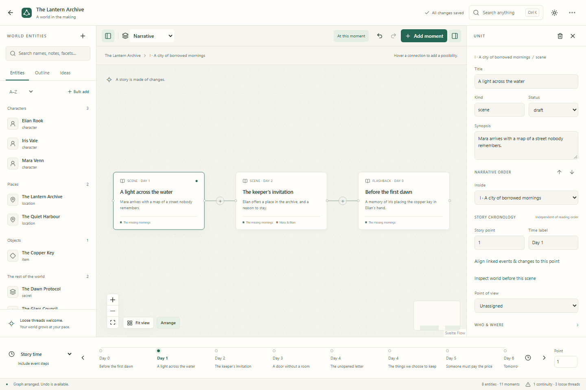

# Warp & Weft Worldbuilder

A private workspace for stories whose worlds change over time. Plan on a graph, inspect a scene, follow a relationship through its history, and write the moment in the same workspace.

The guiding idea: **a story is a graph whose state changes through events.** Reading order and in-world chronology are independent.



[Manuscript editor](static/screenshots/manuscript-dark.png) · [Phone manuscript](static/screenshots/manuscript-mobile.png) · [Recolored graph](static/screenshots/graph-polish.png) · [Dark workspace](static/screenshots/workspace-dark.png) · [Phone writing view](static/screenshots/mobile-writing.png) · [Bulk entity preview](static/screenshots/bulk-entities-dark.png)

[Folder styling](static/screenshots/folder-dark.png) · [Entity summary](static/screenshots/summary-dark.png) · [Phone summary](static/screenshots/summary-mobile.png)

## What you can do

- Create, rename, duplicate, import, and delete story projects.
- Build world entities with multiple facets: people, places, objects, secrets, factions, and your own categories.
- Bulk add up to 500 entities with summaries and full descriptions, default-facet row formats, a preview, duplicate skipping, and one-step undo.
- Organize entities, plot threads, and ideas in nested folders with names, colors, and icons. Drag items and folders to move or reorder them; deleting a folder keeps its contents.
- Double-click pane items for readable summaries and connections, then edit or write. Double-click canvas moments to write or explore inside; timeline points also open summaries.
- Nest acts, scenes, conversations, flashbacks, beats, and notes to any depth.
- Insert scenes into connections; reorder in the outline without changing story timestamps.
- Explore narrative, world, relationship, plot-thread, and chronology lenses.
- Move through labeled story points to inspect changing relationships, knowledge, possessions, location, and custom properties.
- Record scene participants, events, requirements, world changes, and before/after state diffs.
- Follow overlapping threads, capture unplaced ideas, and resolve placeholders.
- Collapse panes and folders, reorder lists, and arrange or fit the canvas with smooth animation. Choose device preference, smooth motion, or reduced motion in Settings & shortcuts.
- Write in a connected manuscript workspace with chapters, rich text/Markdown/read modes, searchable placeholders for every object type, ordered outline population, writing notes, live graph summaries, autosave, and clean Markdown export.
- Preview 192 categorized icons, search and favorite them, tint entire node cards, and move or multiply connection anchors without changing connection identities.
- Delete selected graph objects or connections with Delete/Backspace and undo; release a line on empty canvas to create a connected object at that position.
- Unfollow threads explicitly and open fullscreen graph, entities, inspector, and manuscript views.
- Learn every system through the searchable 126-term [glossary](docs/GLOSSARY.md) and [manuscript guide](docs/MANUSCRIPT.md).
- Search scenes, entities, events, threads, notes, and prose; use Ctrl/⌘ K to navigate or run commands.
- Inspect deterministic continuity observations, including required knowledge/possession and possible delayed reveals.
- Export complete projects as versioned JSON and manuscripts as Markdown. Import creates an independent copy.

## Status

`0.1.0-alpha.1`. This is a single-user local/self-hosted application. See [release status](docs/RELEASE_STATUS.md) for the exact verification results and [known limitations](#known-limitations). It has no account system, collaboration, or public publishing.

## Run locally

Install **Node 24 LTS** and enable the pinned package manager:

```sh
corepack enable
pnpm install --frozen-lockfile
pnpm run setup
pnpm dev
```

Open the local URL printed by Vite (usually `http://127.0.0.1:5173`). Choose **Start a story**, **Explore the demo**, or **Import a story**. No Docker or cloud service is required. The original demo, _The Lantern Archive_, includes a flashback, changing trust, a transferred key, and a deliberate continuity issue.

If your Node installation does not include Corepack, install it with `npm install --global corepack@0.36.0` first. You can also invoke commands as `corepack pnpm ...`. [Development](docs/DEVELOPMENT.md) includes Windows, macOS, and Linux notes.

## Production

```sh
pnpm install --frozen-lockfile
pnpm setup
pnpm build
pnpm start
```

The production server binds to loopback by default. Set `ORIGIN` to the exact URL you use. See [.env.example](.env.example) and [deployment](docs/DEPLOYMENT.md). Runtime environment variables must be provided by the shell or deployment service; `.env` is loaded by Vite in development.

## Docker

```sh
docker compose up --build -d
```

Open `http://localhost:3000`. SQLite is stored in a persistent named volume. `docker compose down` stops the service while keeping writing. Back up before upgrading; **do not use `down -v` unless you intend to delete all stored stories**. See [deployment](docs/DEPLOYMENT.md) for backup and upgrade instructions.

## Commands

| Command            | Purpose                                   |
| ------------------ | ----------------------------------------- |
| `pnpm setup`       | Apply retained Drizzle migrations         |
| `pnpm dev`         | Local development server                  |
| `pnpm lint`        | ESLint and formatting checks              |
| `pnpm check`       | Strict TypeScript and Svelte checks       |
| `pnpm test`        | Domain and SQLite integration tests       |
| `pnpm test:e2e`    | Chromium writer workflows                 |
| `pnpm build`       | Build the production Node server          |
| `pnpm start`       | Start the built server                    |
| `pnpm backup`      | Create a consistent local SQLite backup   |
| `pnpm db:generate` | Generate a migration after schema changes |

Install the browser once with `pnpm exec playwright install chromium` before E2E tests. On Linux CI, use `--with-deps`.

## Privacy and ownership

No telemetry, analytics, trackers, hosted fonts, advertising, or external AI requests. Writing goes only to the installation you run. SQLite data lives in `data/storygraph.db` by default. Failed/pending saves also have a recovery copy in that browser's local storage. Data is not encrypted by the app. [Privacy](docs/PRIVACY.md) explains storage and network behavior.

Complete exports include entities, facets, nested structure, ordering, chronology, histories, changes, requirements, threads, prose, references, and saved layouts. You own your writing; the application license does not change that. See the [export format](docs/EXPORT_FORMAT.md).

## AI status

Off. A typed provider boundary exists for local and generic OpenAI-compatible integrations. No provider performs requests in this release. Settings describe this honestly; core features work without AI.

## Known limitations

- Single user and one installation owner. Public deployments need a private network or reverse-proxy access control.
- Undo history is limited to 50 workspace transactions and is not retained after reload; prose has its own editor history.
- Undo preserves newer prose. If merged writing is edited before undo, restored moments can contain overlapping passages that need manual reconciliation.
- Story placeholders use a searchable picker across moments, entities, events, relationships, and threads. Typing `@` autocomplete is not implemented.
- Export is a single `.warp-weft.json` file. Legacy `.storygraph.json` files still import. Attachments are not implemented.
- Temporal filtering shows modeled active relationships and property snapshots. Entity lifetimes/existence intervals are not modeled.
- Event steps resolve changes within a story point using modeled order. Without a causing event, relationship transitions use order zero.
- Placeholder entities/events retain their original narrative envelope and connections. Merging into an existing moment joins prose and children; it does not reinterpret story timestamps.
- State requirements produce grounded checks, not an understanding of unmodeled prose. Location checks compare explicitly recorded simultaneous settings; durations/travel-time simulation are not implemented.
- Full-project saves favor correctness and atomic undo over very large manuscript throughput. Projection performance is tested at hundreds of entities and thousands of edges; large-project browser benchmarking remains a roadmap item.
- Projects/import requests are limited to 20 MB. Individual descriptions and scene plain text are limited to 200,000 characters; large manuscripts should use separate scenes.
- Graph accessibility has non-pointer alternatives through the outline, inspector, timeline, and command palette. It is not a fully accessible spatial diagram for screen-reader users.
- Pane items support Alt+↑/↓ for sibling reordering and Alt+Enter for summaries. On touch screens, use summary folder selection and inspector controls; native drag organization is intended for a mouse or trackpad.

## Contributing and roadmap

See [CONTRIBUTING.md](CONTRIBUTING.md), [CODE_OF_CONDUCT.md](CODE_OF_CONDUCT.md), [security](SECURITY.md), and the [roadmap](docs/ROADMAP.md). Architecture, domain semantics, export format, design, testing, and deployment documentation live in [docs](docs/ARCHITECTURE.md). The original concept and implementation contract are retained in [IDEA.md](IDEA.md) and [PROMPT.md](PROMPT.md).

## License

Apache-2.0. See [LICENSE](LICENSE). The original example story is included under the same license. User-authored stories remain their authors' property.
